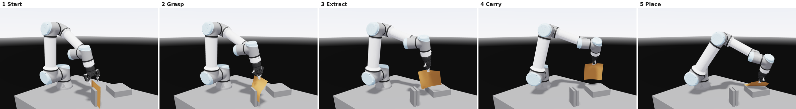
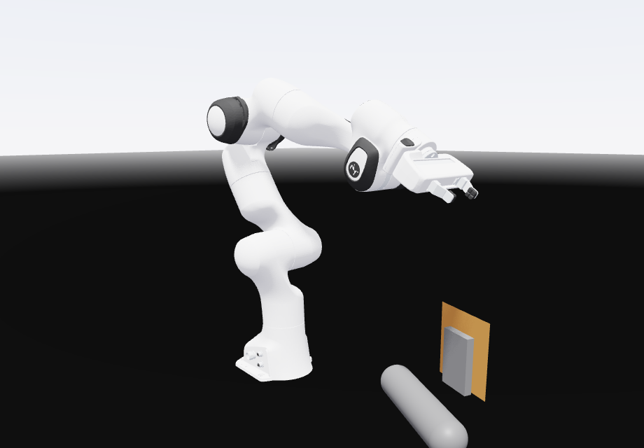
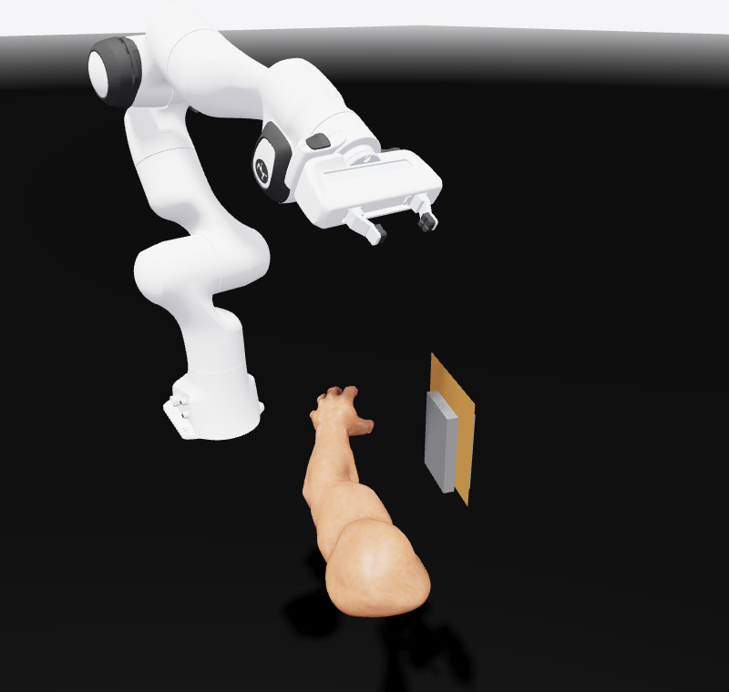
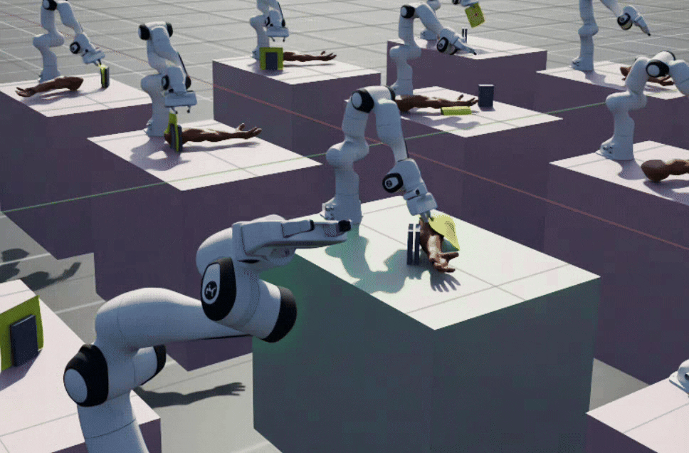
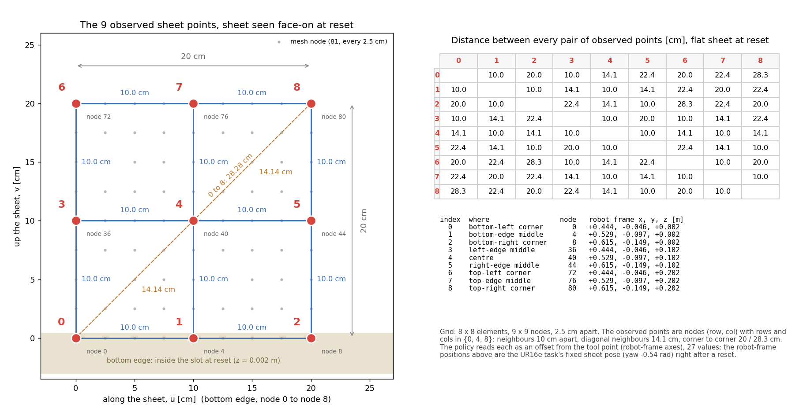
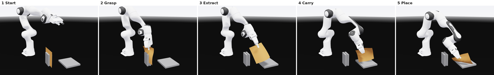
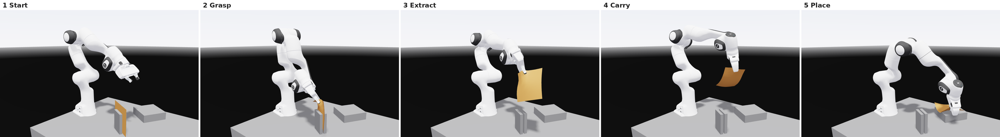

# Learning to Handle a Deformable Sheet: from Wound-Dressing Drapes to a Real UR16e

Reinforcement learning for picking up a thin cloth sheet, carrying it and laying it down. It is built in
[Isaac Lab](https://github.com/isaac-sim/IsaacLab) on the Newton physics backend: VBD cloth, MuJoCo-Warp robot,
and a rigid-to-soft coupler. Three tasks share the same sheet, observations and training machinery:

- the sheet is drawn out of a slot that holds it on edge;
- it is draped over a sculpted forearm (the wound-dressing scenario);
- it is placed on a platform whose pose is commanded.

Over the course of the project the control interface moved from **joint space** to a **task-space twist**
(a delta pose of the tool point). The observation moved from **robot joint state** to a **tool-relative,
robot-independent** set of 49 values. That path takes a policy trained on a Franka Panda to a UR10e, then
unchanged to a UR16e, and finally to an exported ONNX controller for the real UR16e.

<p align="center">
  
</p>
<p align="center"><sub><b>Figure 1.</b> The kept policy <code>best_twist_slow_3950</code> on the UR16e with a Robotiq
2F-85, one deterministic episode at the arm action scale used on the real robot (0.03). It pinches the sheet's free
edge in the slot, draws it out, carries it, and releases it over the platform. Headless Newton GL frames 0, 40, 90,
150 and 210 (50 Hz).</sub></p>

---

## Contents

1. [Problem and application](#1-problem-and-application)
2. [Simulation](#2-simulation)
3. [The task family](#3-the-task-family)
4. [Action spaces, from joints to twists](#4-action-spaces-from-joints-to-twists)
5. [Observation spaces, from joint state to a robot-independent set](#5-observation-spaces-from-joint-state-to-a-robot-independent-set)
6. [Reward and episode outcomes](#6-reward-and-episode-outcomes)
7. [Learning pipeline](#7-learning-pipeline)
8. [Results](#8-results)
9. [Perception: simulated depth camera](#9-perception-simulated-depth-camera)
10. [Transfer to the real UR16e](#10-transfer-to-the-real-ur16e)
11. [Reproducing](#11-reproducing)
12. [Repository layout](#12-repository-layout)
13. [Lessons and limitations](#13-lessons-and-limitations)
14. [Further documentation](#14-further-documentation)

---

## 1. Problem and application

Part of this work targets **robotic wound dressing on the arm**. A dressing-like sheet has to be picked up from where
it is presented and laid over a forearm. Two properties make this hard for a robot:

1. **A flat sheet offers nothing to grasp.** A gripper cannot get a finger under fabric lying on a surface. The sheet
   is therefore presented **on edge in a narrow slot** (two walls 1 cm apart), with about 5 cm standing free. That
   free edge can be pinched side-on, the way a dispenser presents a dressing.
2. **The sheet's state is high-dimensional and only partly observable.** It is described by nine landmarks on a
   9 × 9 node mesh. The policy has to judge the grasp, the extraction and the drape from those nine points alone.

Two scenes cover the dressing scenario: a capsule proxy of the forearm, and a sculpted mesh arm and hand (Figure 2).
The **platform task** then turns "lay the sheet down there" into a quantity that can be measured and commanded. The
target is a rectangle with a pose and height randomised per episode, and success is the platform coverage and
squareness at release. This task carries the controller through the change of action space and robot, and on to the
real robot.

<p align="center">
  
  
  
</p>
<p align="center"><sub><b>Figure 2.</b> The wound-dressing scenes. Left: the sheet in its slot beside a capsule
forearm proxy (<code>Template-Sheet-Rl-v0</code>). Middle: the sculpted mannequin arm and hand
(<code>Template-Sheet-Rl-Hand-v0</code>). Right: a learned drape over the forearm, many environments in parallel
(<a href="media/hand_placement.gif">palm down</a>, <a href="media/Second_arm.gif">palm up</a>, animated GIFs).</sub></p>

## 2. Simulation

| Component | Setting |
|---|---|
| Framework | Isaac Lab, manager-based environments, Newton physics backend |
| Cloth | 20 × 20 cm sheet, 8 × 8 elements (**9 × 9 nodes, 2.5 cm apart**), VBD solver |
| Robot | MuJoCo-Warp articulation, coupled to the cloth through finger and hand colliders |
| Robots used | Franka Panda (parallel fingers); UR10e and UR16e with a Robotiq 2F-85 (mimic-joint gripper) |
| Slot | two 10 × 2 × 15 cm walls, 1 cm gap; the sheet's bottom edge sits inside at reset |
| Platform | 2 cm slab (joint-space tasks) or a sunk 20 cm box whose top height is drawn per episode (twist tasks) |
| Layout randomisation | sheet and slot ±5 cm and ±45° yaw; platform pose from the goal command; platform height U(0.02, 0.14) m |
| Rendering | headless Newton GL for figures and videos; Newton Warp ray tracer for the simulated D435i |

**What the policy sees of the sheet: nine landmarks.** These are nodes 0, 4, 8, 36, 40, 44, 72, 76 and 80 of the
mesh: corners, edge midpoints and the centre. Neighbours are 10 cm apart and the corners 28.3 cm diagonally
(Figure 3). The same nine points are measured on the real sheet with OptiTrack markers (§10).

<p align="center">
  
</p>
<p align="center"><sub><b>Figure 3.</b> The nine observed landmarks on the 9 × 9 node sheet, their pairwise distances,
and their robot-frame positions at reset in the UR16e task (sheet yaw −0.54 rad).</sub></p>

## 3. The task family

Every task is a Gymnasium id registered by `source/sheet_rl/sheet_rl/tasks/`. The observation and action columns
were read from each environment's own manager tables (`scripts/readme_shots.py` writes them out).

| Task id | Robot | Action (dim) | Policy observation (dim) | Control | Episode | Purpose |
|---|---|---|---|---|---|---|
| `Template-Sheet-Rl-v0` | Franka | relative joint position + binary gripper (**8**) | `policy` (**60**) | 30 Hz | 500 steps (16.7 s) | extract the sheet from the slot; capsule forearm proxy |
| `Template-Sheet-Rl-Hand-v0` | Franka | as above (8) | `policy` (60) | 30 Hz | 500 | the same with the sculpted mesh arm and hand (dressing drape) |
| `Template-Sheet-Rl-Platform-v0`, `…-Platform-Grasp-v0` | Franka | smoothed relative joint position + filtered gripper (**8**) | `policy` (60) | 30 Hz | 1000 (33.3 s) | grasp, extract, place on a 2 cm slab (grasp-only variant) |
| `Lift-Cube-Franka-Twist-*` (side project) | Franka | twist (7) | 35 | 50 Hz | — | the joint-to-twist conversion, worked out on a cube ([details](FRANKA_LIFT_TWIST.md)) |
| `Template-Sheet-Rl-Platform-Twist-v0` | Franka | **twist** (6-D delta pose ×0.5 + gripper, **7**) | `policy` (**59**) | **50 Hz** | 900 | the cube teacher's plant: stiff, gravity-compensated arm; platform of random height |
| `…-Platform-Twist-Rigid-v0`, `…-Twist-OrigReward-v0` | Franka | twist (7) | `policy` (59) | 50 Hz | 900 | a rigid plate instead of cloth; the original reward on the twist plant (evaluation bridge) |
| `Template-Sheet-Rl-Platform-TwistStudent-v0` | Franka | twist (×0.1) + filtered gripper (**7**) | `policy` (59) **and** `action_history` (**49**) | 50 Hz | 1500 (30 s) | the full platform task under twist control: **the student task** |
| `…-TwistStudent-UR10e-v0` | UR10e + 2F-85 | twist on `wrist_3_link` + 0.145 m (7) | `policy` (59), `action_history` (49), critic `ur_critic` (55) | 50 Hz | 1500 | the student task on a UR: PPO fine-tunes, joint-speed limits |
| `…-TwistStudent-UR16e-v0` | UR16e + 2F-85 | as UR10e (7) | as UR10e | 50 Hz | 1500 | the UR10e task on the UR16e, the arm used on the real robot |
| `…-TwistStudent-UR16e-Camera-v0` | UR16e + 2F-85 | as UR16e (7) | as UR16e | 50 Hz | 1500 | plus a simulated RealSense D435i and AprilTags (§9) |

The UR16e environment used for transfer is
[`sheet_ur16e_env_cfg.py`](source/sheet_rl/sheet_rl/tasks/manager_based/sheet_twist/sheet_ur16e_env_cfg.py)
(`SheetUR16eTwistStudentEnvCfg`). It inherits as follows:

```
SheetUR16eTwistStudentEnvCfg        sheet_twist/sheet_ur16e_env_cfg.py               UR16e arm, start pose, self-collision
 └ SheetUR10eTwistStudentEnvCfg     sheet_twist/sheet_ur10e_env_cfg.py               UR twist action, 2F-85, tool point, fault exit
    └ SheetPlatformTwistStudentEnvCfg  sheet_twist/sheet_platform_twist_student_env_cfg.py   observation groups, outcomes, rewards
       └ SheetRlPlatformEnvCfg      sheet_rl/sheet_rl_platform_env_cfg.py            scene, layout, goal command, base terms
```

## 4. Action spaces, from joints to twists

Every action has the same structure: an **arm part** and **one gripper channel**. What changed is what the arm part
means.

**(a) Relative joint position: slot and arm tasks (8 = 7 + 1).** Each step moves the joint targets:
$q^{\ast}_{t+1} = q_t + 0.03\,a_{0:7}$. The gripper is binary: fully open at $a_7 \ge 0$, fully closed below.
A continuous gripper channel was tried and dropped. The policy loitered at half-open widths, so the open-then-close
events the grasp reward pays for never cleanly happened.

**(b) Smoothed relative joint position: joint-space platform task (8).** The same, at scale 0.02, with a first-order
filter on the arm command. The gripper becomes **filtered binary**:
$s \leftarrow s + 0.3\,(\mathrm{clip}(a_g,-1,1) - s)$ with $s_0 = 0.5$, and the gripper is open iff $s > 0$. The
filtered state is observed, so the policy knows where the gripper is heading.

<p align="center">
  
</p>
<p align="center"><sub><b>Figure 4.</b> Joint-space control: <code>Template-Sheet-Rl-Platform-v0</code> with the
policy <code>placement_3319_joint_limits</code>, frames 0–150 at 30 Hz. The table in this task is an invisible
collider, so the slot and the 2 cm slab appear to float.</sub></p>

**(c) Twist, a delta pose of the tool point: all later tasks (7 = 6 + 1).** The arm action is a 6-D increment of the
tool pose, expressed in the robot base frame. Damped least-squares IK turns it into joint targets on every physics
step. With measured tool pose $(p, R)$ and scale $k$:

$$
p^{\ast} = p + k\,a_{0:3}, \qquad R^{\ast} = \exp\!\big([k\,a_{3:6}]_\times\big)\,R ,
$$

The rotation is an axis-angle vector, left-multiplied in base axes, and pivots about the tool point. Every step
starts again from the **measured** pose, so a zero action means "stay where you are". The tool point and scale per
robot:

| Robot | Tool point | Scale $k$ |
|---|---|---|
| Franka | `panda_hand` + 0.107 m | 0.5 in the cube teacher's plant, 0.1 in the student task; randomised U(0.04, 0.1) per episode during SAC |
| UR | `wrist_3_link` (= ROS `tool0`) + 0.145 m, the 2F-85 pad midpoint | 0.03 on the real arm |

**Why the change.** A joint-space policy is tied to one kinematic chain. A twist is not: the same tool-point motion
can be produced on a Franka, a UR10e or a UR16e, and on the real robot through a Cartesian controller. The cost is the
conversion of existing joint-space policies. A joint teacher drives **saturated** position actuators, sitting 2–8 rad
from its targets, so its targets are torque commands rather than poses. A geometric conversion of them imitates
nothing (0 % success). Labels that **match the torque** the teacher's drive applies give 75–89 %. This is worked out in
[FRANKA_LIFT_TWIST.md](FRANKA_LIFT_TWIST.md).

<p align="center">
  
</p>
<p align="center"><sub><b>Figure 5.</b> Twist control on the Franka: <code>Template-Sheet-Rl-Platform-TwistStudent-v0</code>
with the PPO policy <code>best_deformable_twist</code> (model_2874), frames 0–70 at 50 Hz. Compare with the UR16e in
Figure 1: the same task and observation interface, with a different arm under the same action.</sub></p>

## 5. Observation spaces, from joint state to a robot-independent set

**`policy` (60, then 59): the original group.** All positions are in the robot base frame.

| Slice | Term | Size |
|---|---|---|
| 0:9 | joint positions (7 arm + 2 fingers) | 9 |
| 9:18 | joint velocities | 9 |
| 18:45 | the nine sheet landmarks | 27 |
| 45:52 | goal (platform top-centre) position and quaternion | 7 |
| 52:60 / 52:59 | the last applied action: 8 for joint control, 7 for twist control | 8 / 7 |

It is complete for one robot but cannot transfer. The joint state belongs to the Franka, and positions taken from
the base depend on where the base stands.

**`action_history` (49): the transferable group.** It was introduced for the student and is the only input of every
policy run on the UR arms and on the real robot:

| Slice | Term | Size | Frame |
|---|---|---|---|
| 0:7, 7:14 | the **last two applied actions**: six raw arm outputs + the filtered gripper state; reset value `[0,0,0,0,0,0,0.5]` | 14 | — |
| 14:41 | the nine landmarks **minus the tool point** | 27 | base axes |
| 41:44 | platform top-centre **minus the tool point** | 3 | base axes |
| 44:48 | platform quaternion (x, y, z, w) | 4 | base |
| 48 | finger **pad gap** | 1 | m |

There is no joint state, and every position is a difference from the tool point, so the base's position cancels and
only its orientation remains. A policy reading this group does not know which arm it drives. That is what lets the
same weights run on the UR10e and the UR16e. The two most recent actions stand in for the velocity information the
joint state used to carry.

**Two further groups:**
- `action_history_legacy` keeps the pre-repair version of channel 49 (index 48). Earlier actors read there a sum over
  the nine joint positions instead of the pad gap. Those checkpoints still need it, and §7 describes the repair.
- `ur_critic` (55) is an **asymmetric critic** input on the UR arms: the UR's own joint state, the landmarks, the
  goal and the last action. The critic may see what the actor must not.

## 6. Reward and episode outcomes

The platform tasks share a staged structure. The terms and weights below are from the UR16e environment; weights
there are divided by 35.

| Stage | Terms | What they pay for |
|---|---|---|
| reach and grasp | `grasp_progress`, `grasp_stage`, `gripper_closures` | potential-based approach to the free edge; one-shot bonuses for the first grasp and for extraction, judged on cloth actually between the pads; a charge per extra closure |
| lift | `lift_milestones` | one-shot height milestones while holding |
| carry and place | `placement`, `center_progress`, `placed_coverage` | budgeted placement/retreat term; progress of the sheet's centre toward the platform top (paid on new bests only); a success bonus exponential in the coverage at release |
| safety and smoothness | `table_clearance`, `ee_speed`, `fault_exit` (−100 on UR), `tool_speed_over` | keep clear of the table; hand speed; arm-into-table, self-collision and joint-speed exits; tool speed above 0.5 m/s (on for `best_twist_slow_3950`) |
| diagnostics | `coverage`, `release_angle` | logged only (weight ≈ 0) |

**One gripper cycle per episode.** The first closing command is the grasp, and the first opening command after it is
the release. The release ends the episode on that step, judged on the coverage it was made with:
- **`placed`** (success): at least **50 %** of the platform covered at release **and** the sheet's marked edge within
  **20°** of a platform edge.
- **`dropped`**: any other release (less coverage or more yaw).

Other exits:
- `held_too_low`;
- `released_high`;
- the sheet leaving its bounds;
- the tool below the table;
- a finger touching the slot;
- arm self-collision or arm into the table;
- the joint-speed limit (60 % of the real limits for the kept UR policy);
- a solver divergence guard.

The twist teacher's plant (`…-Twist-v0`) uses its own pick-and-place reward instead: reach, align, hold,
`lift_goal`, `layout`, `released_coverage`, completion, and motion charges.

## 7. Learning pipeline

```mermaid
flowchart LR
  A["Joint-space PPO<br/>slot · arm · platform<br/>(Franka, 60 obs, 8 act)"] --> B["Cube lift: joint teacher<br/>→ torque-matched DAgger<br/>→ twist policy"]
  B --> C["Sheet twist plant<br/>DAgger from cube teacher,<br/>rigid plate → cloth<br/>(hr0032_window1 / model_348)"]
  C --> D["Student task, PPO<br/>(s348 lineage)<br/>best_deformable_twist<br/>model_2874 · 59 obs"]
  D --> E["Critic warm-up + DAgger<br/>→ FastSAC student<br/>on action_history (49)"]
  E --> F["FastSAC fine-tune<br/>IK-scale & ±45° yaw<br/>randomisation (par_D2, par_I)"]
  F --> G["Channel-49 repair (index 48)<br/>DAgger, stochastic teacher<br/>repair49_rand_std"]
  G --> H["UR10e PPO fine-tune<br/>no KL, learned std 0.45<br/>best_ur10e_ppo / 925"]
  H --> I["Joint-speed limit<br/>best_twist_velterm_1924"]
  I --> J["60 % joint limit +<br/>tool-speed penalty<br/>best_twist_slow_3950"]
  J --> K["UR16e (zero-shot)<br/>→ ONNX export<br/>→ real robot"]
```



**Algorithms.**
- **PPO** (rsl-rl) is used throughout. For fine-tuning pretrained actors there is a variant with a frozen
  KL-reference copy, a stochastic critic warm-up, and a learned or fixed exploration std.
- **DAgger** is used for every change of interface: joint → twist, Franka plant → student task, and the repair of
  observation channel 49 (index 48).
- **FastSAC**, ported from holosoma: twin C51 distributional critics, n-step replay, pessimistic Q targets and a frozen
  actor observation normaliser. It was used to make the student robust to the IK scale and to layout yaw.

**Lessons that set the recipe:**
- Labels for a twist student must be **torque-matched**, not converted geometrically.
- A pretrained actor loaded into SAC needs its **observation normaliser frozen**; replay statistics collapsed the
  student otherwise.
- When fine-tuning a pretrained actor stalls, **widen the exploration std and raise the learning rate** before
  blaming the critic. This is what unlocked the UR10e transfer: 0 % → 80 % placed.
- The policy fed to the real arm was trained under the real arm's **joint-speed limits** (cut to 60 %) and a
  **tool-speed penalty**, so it moves at about a third of the speed of the unconstrained policy.

## 8. Results

Success is `placed` (§6). Rates come from training windows (about 1000 environments) or from the evaluations named.
Newton cloth is non-deterministic: the same seed and actions flip 17–19 % of outcomes, so expect ±3–4 points of
noise even over 1000 episodes.

| Policy | Robot / task | Observation | Result |
|---|---|---|---|
| `sheet_platform_twist/best_deformable_twist/model_2874` (PPO) | Franka, student task, IK scale 0.1 | `policy` (59) | final window: 68 % placed, extraction 97 %, yaw error 11.3°. 512 episodes: deterministic 0.871, stochastic 0.738 |
| FastSAC `best_of_sac/model_66500` | Franka, scale 0.1 | legacy (49) | stochastic 0.893, deterministic 0.896, but 0.52 under random scale |
| FastSAC `par_I_yaw45_fixed/model_93500` | Franka, full randomisation (scale 0.04–0.1, ±5 cm, ±45°) | legacy (49) | 512 episodes: stochastic 0.699, deterministic 0.717 |
| DAgger `repair49_rand_std/model_200` | Franka, full randomisation | `action_history` (49) | 512 episodes: stochastic 0.677, deterministic 0.680 |
| PPO `best_ur10e_ppo/model_925` | **UR10e**, scale 0.03–0.1 | `action_history` | 80 % placed, 86 % extracted; deterministic check 30/32 releases placed. The untransferred Franka student placed 0/50 |
| PPO `best_twist_velterm_1924/model_1924` | UR10e with the joint-speed limit, scale 0.015–0.1 | `action_history` | 79.3 % placed; **the same weights on the UR16e** gave the same outcome in every one of 10 deterministic episodes |
| **PPO `best_twist_slow_3950/model_3950`** | **UR10e / UR16e**, 60 % joint limit + tool-speed penalty | `action_history` | **81.9 % placed**; one episode at scale 0.03 places in 4.3 s with the tool peaking at **0.34 m/s** (model_1924: 1.9 s, 0.87 m/s), under the real arm's 0.45 m/s cap |

Each kept checkpoint folder has a `PROVENANCE.md` with its lineage, metrics and the exact command.

## 9. Perception: simulated depth camera

`…-UR16e-Camera-v0` adds a **RealSense D435i** to the UR16e scene for perception work. The policy does not read it.

- **Camera:** colour, 640 × 480, fx = fy = 615 px, at (1.2, 0, 0.75) m, tilted 35° down. Rendered by Newton's Warp
  ray tracer, so the cloth renders as well.
- **AprilTags (36h11):**
  - a 10 cm tag by the base: its distance measures 1.182 m against 1.181 m true, with `CORNER_REFINE_APRILTAG`;
  - a second tag on the right;
  - an 80 cm floor tag that stays visible, placed with `scripts/floor_tag_gui.py`.
- **Depth-Anything-3:** metric depth from the colour image, served from a docker over TCP. Corrected per frame from the
  tags (`scripts/depth_scale.py`): near-range error **37–41 %** raw, about 3.5 % with one tag, **1.9 %** with two tags
  at different depths. DA3 is not affine over range, so the fit uses the near tags.
- **Point cloud:** a calibrated point cloud of up to 2–3 m, in its own process window.

```bash
PYOPENGL_PLATFORM=glx python scripts/play_actor.py --task Template-Sheet-Rl-Platform-TwistStudent-UR16e-Camera-v0 \
  --checkpoint logs/rsl_rl/sheet_platform_twist_ur10e_ppo/best_twist_slow_3950/model_3950.pt \
  --viz newton_gl --num_envs 1 --real-time --camera d435i [--depth] [--marker] [--point_cloud] \
  env.actions.arm_action.scale=0.03 env.terminations.joint_vel_out_of_limit.params.limit_scale=0.6
```

## 10. Transfer to the real UR16e

**Export.** `scripts/export_real_policy.py` writes the deterministic actor into
`best_twist_slow_3950/exported_real/`. The observation normaliser and tanh are inside the export: raw 49 values in,
7 actions out.
- `policy.onnx` (opset 17) and `policy.pt`;
- `policy_spec.json`: the layout, frames, action scale and gripper filter.

It agrees with the simulator to 5 × 10⁻⁶ on a recorded episode.

**The frames are the same on both sides:**
- the simulator's robot root is ROS `base_link`;
- `wrist_3_link` is `tool0`, and the tool point is `tool0` + 0.145 m along z;
- quaternions are (x, y, z, w);
- control runs at 50 Hz, arm scale 0.03.

**Measurement on the real side.** It is a separate ROS 2 package,
[`hrii_sheet_mocap`](/home/hami/workspaces/ros_two/optitrack_ws/src/hrii_sheet_mocap/README.md):
- **The sheet:** ten OptiTrack markers on the real sheet give the nine landmarks plus a helper marker. Identification,
  tracking, rigid-fit filling of hidden markers and re-finding after dropouts are included.
- **The platform:** an OptiTrack rigid body.
- **The robot:** the UR16e's ROS 1 state, relayed one way into ROS 2.
- **Calibration:** OptiTrack ↔ robot and bar calibration GUIs.
- **The policy node:** assembles exactly the 49 values above, verified against a simulated episode to under 10 µm.
  It runs the ONNX actor in observe, shadow or execute mode.

The full architecture and the operating commands are in
[`SIM_TO_REAL_ARCHITECTURE.md`](/home/hami/workspaces/ros_two/optitrack_ws/src/hrii_sheet_mocap/SIM_TO_REAL_ARCHITECTURE.md).
**A complete physical rollout has not yet been confirmed.**

## 11. Reproducing

Use the Isaac Lab environment (`source IsaacLab/env_isaaclab/bin/activate`, alias `active_isaac`), and run every
command from this directory. Use `unittest`, not pytest.

```bash
python -m pip install -e source/sheet_rl          # once
python scripts/list_envs.py                       # the task ids of §3
```

**Train.** These are representative commands; [`docs/OPERATIONS.md`](docs/OPERATIONS.md) and the `PROVENANCE.md`
files have every flag.

```bash
# joint-space slot task (PPO)
python scripts/train.py --rl_library rsl_rl --task Template-Sheet-Rl-v0 --num_envs 1024 \
  agent.experiment_name=sheet_grasp agent.run_name=grasp_v1 agent.max_iterations=3000
# joint-space platform task
python scripts/train_platform.py --num_envs 1024 --viz none
# FastSAC on the student task (full randomisation)
python scripts/train_sac.py --task Template-Sheet-Rl-Platform-TwistStudent-v0 --num_envs 1024 \
  env.events.randomize_arm_scale.params.scale_range=[0.04,0.1] \
  env.events.reset_layout.params.sheet_xy_jitter=0.05 env.events.reset_layout.params.sheet_yaw_jitter=0.7854
```

**Watch a kept policy.** Use the Newton GL viewer (`--viz newton_gl`).

```bash
PYOPENGL_PLATFORM=glx python scripts/play_actor.py --task Template-Sheet-Rl-Platform-TwistStudent-UR16e-v0 \
  --checkpoint logs/rsl_rl/sheet_platform_twist_ur10e_ppo/best_twist_slow_3950/model_3950.pt \
  --viz newton_gl --num_envs 1 --real-time \
  env.actions.arm_action.scale=0.03 env.terminations.joint_vel_out_of_limit.params.limit_scale=0.6
```

**Export, and regenerate the figures and space tables of this README:**

```bash
python scripts/export_real_policy.py \
  --checkpoint logs/rsl_rl/sheet_platform_twist_ur10e_ppo/best_twist_slow_3950/model_3950.pt --arm_action_scale 0.03
PYOPENGL_PLATFORM=glx python scripts/readme_shots.py --task Template-Sheet-Rl-Platform-TwistStudent-UR16e-v0 \
  --policy logs/rsl_rl/sheet_platform_twist_ur10e_ppo/best_twist_slow_3950/exported_real/policy.pt \
  --obs_group action_history --every 10 --until 230 --camera 1.05 -0.95 0.62 0.28 0.05 0.22 \
  --name ur16e --light_sky env.actions.arm_action.scale=0.03 \
  env.terminations.joint_vel_out_of_limit.params.limit_scale=0.6 env.scene.table.spawn.visible=True
```

`readme_shots.py` writes the PNG frames and `<name>_spaces.txt`, the environment's own observation, action, command,
termination and reward tables.

## 12. Repository layout

```
source/sheet_rl/sheet_rl/
├── tasks/manager_based/
│   ├── sheet_rl/            joint-space slot, hand and platform tasks; shared MDP terms (mdp/)
│   ├── sheet_twist/         twist plant, student task, UR10e / UR16e / camera tasks, tags, D435i
│   └── franka_lift_twist/   the cube-lift joint-to-twist side project
└── algorithms/fast_sac/     FastSAC (networks, replay, update, Isaac Lab adapter)
scripts/                     train / play / evaluate / DAgger / export / GUIs / camera & depth tools
logs/                        rsl_rl and fast_sac runs; kept policies carry PROVENANCE.md
evaluations/                 saved evaluation JSONs and figures
media/                       GIFs and the figures of this README (media/readme/)
hand_model/                  the sculpted arm-and-hand asset
docs/OPERATIONS.md           the previous README: detailed commands and per-policy notes
```

## 13. Lessons and limitations

- **The cloth is non-deterministic.** Outcomes flip in 17–19 % of replays with the same seed and actions. Ten-episode
  checks are coarse; compare policies on 512 episodes or more.
- **Saturated joint teachers command torque, not pose.** Any interface change needs torque-matched labels.
- **Observation bugs can be load-bearing.** The legacy channel 49 held a sum over the nine joint positions. The trained
  actors relied on it, so it had to be repaired by DAgger rather than simply corrected.
- **The tool point is part of the policy.** The UR-trained weights run on the Franka only with the tool point moved
  13.2 mm toward the flange (0.0938 m).
- **Not modelled in simulation:**
  - the real Cartesian controller's dynamics;
  - the real 2F-85's timing;
  - collisions with the real table and its surroundings;
  - marker occlusion beyond what the mocap filling handles.

  Matching interfaces is not matching dynamics.

## 14. Further documentation

| Document | Content |
|---|---|
| [docs/OPERATIONS.md](docs/OPERATIONS.md) | the previous README, verbatim: every command, flag and per-policy note |
| [PLATFORM_TASK.md](PLATFORM_TASK.md) | the joint-space platform task, its staged reward and smoothing |
| [FRANKA_LIFT_TWIST.md](FRANKA_LIFT_TWIST.md) | joint teacher → torque-matched DAgger → twist policy, on the cube |
| [SESSION_HANDOFF_2026-10-27.md](SESSION_HANDOFF_2026-10-27.md) | status, weights and lineage; §9 covers the real-world side |
| [HANDOFF_REAL_ENV_2026-11-17.md](HANDOFF_REAL_ENV_2026-11-17.md) | the real-environment implementation history |
| `logs/**/PROVENANCE.md` | per-policy lineage, numbers and commands |

**Developed against** Isaac Lab `68d7f932d` and rsl-rl-lib `5.4.1`. The tasks subclass Isaac Lab internals
(`FrankaClothEnvCfg`, the lift MDP, Newton articulation data), so upstream changes can break them.
